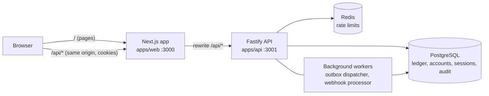
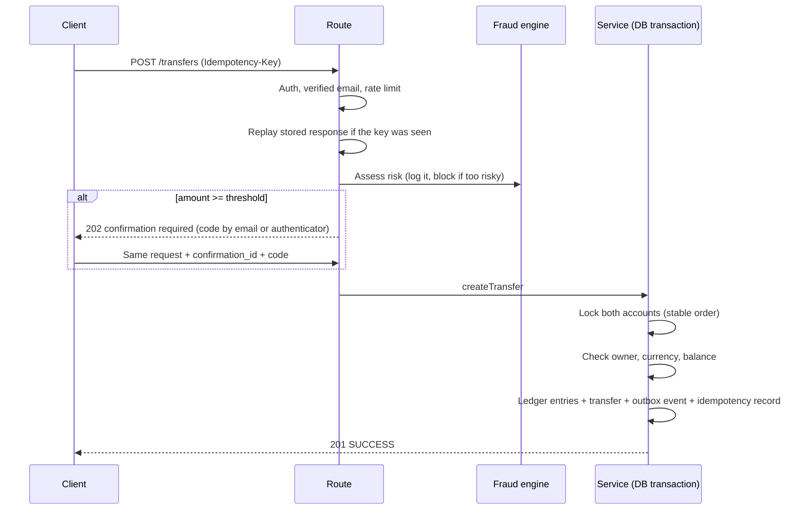
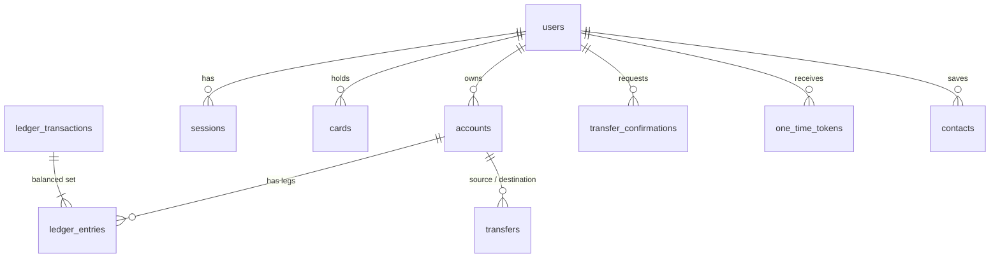

# VaultCore

[](https://github.com/kuchinsk1y/vaultcore-payment-system/actions/workflows/ci.yml)


**A multi-currency digital bank in a sandbox: double-entry ledger, safe money movement, and a security model modelled on real banking apps.**

VaultCore is a full-stack pet project: a Fastify + PostgreSQL backend and a Next.js dashboard. It is built to show how the hard parts of a payment system work: correctness under concurrency, idempotent operations, an immutable ledger, and account security (rotating sessions, two-factor authentication, step-up confirmation of large transfers, audit trail).

> **Sandbox only.** No real money or payment network is involved. Top-ups are simulated, exchange rates are fixed values stored in the database, and emails are printed to the server log.

---

## Contents

- [What you can do](#what-you-can-do)
- [Engineering highlights](#engineering-highlights)
- [Tech stack](#tech-stack)
- [Architecture](#architecture)
- [Getting started](#getting-started)
- [Configuration](#configuration)
- [Scripts](#scripts)
- [Testing](#testing)
- [API overview](#api-overview)
- [Security model](#security-model)
- [Limitations and ideas](#limitations-and-ideas)

---

## What you can do

| Area | Capabilities |
|---|---|
| **Accounts** | Open one account per currency (EUR, USD, PLN) and see balances derived from the ledger. |
| **Dashboard** | Total balance with a real 30-day change, income and expenses for the month, balance history chart, spending by category, recent activity, and a getting-started checklist for new users. Every block loads and fails independently with a retry. |
| **Transfers** | Send money to a saved contact or any account by id. Idempotent, atomic, with a fraud check. Large transfers require a one-time code. |
| **Transactions** | Full history across accounts with search, filters (account, type, direction, dates), exact keyset pagination and CSV export. |
| **Exchange** | Convert between your own accounts at the platform rate, with a preview that matches exactly what is credited. |
| **Top-up** | Add demo funds to an account (rate limited, with per-request and rolling 24-hour caps). |
| **Cards** | Issue virtual cards, freeze / unfreeze, set a PIN. |
| **Contacts** | Find people by phone number and save them for quick transfers. |
| **Security** | Sessions list, log out everywhere, password change / reset, email verification, TOTP two-factor authentication, personal activity log. |
| **Preferences** | English, Russian, German and Polish; light and dark themes; balance privacy toggle. |

---

## Engineering highlights

| Problem | Solution |
|---|---|
| Balances must never drift | **Double-entry ledger.** Every movement is a balanced set of `DEBIT`/`CREDIT` entries; balances are *derived* from entries, never stored or overwritten. Transactions are classified (`TRANSFER`, `EXCHANGE`, `TOP_UP`, `DEPOSIT`). |
| Two requests spending the same money | **ACID transactions with row locks.** Accounts are locked with `SELECT … FOR UPDATE` in a stable order, which also prevents deadlocks. A 30-request concurrency storm is part of the test suite. |
| Client retries cause double charges | **Idempotency keys** stored with the response; concurrent duplicates resolve through a unique constraint. |
| Events lost between DB and the outside world | **Transactional outbox** written in the same transaction as the business change, drained by workers using `FOR UPDATE SKIP LOCKED`. |
| Duplicate / replayed gateway callbacks | **Webhook inbox** with deduplication and an idempotent processor. |
| Stolen refresh token | **Rotating refresh tokens with reuse detection**: replaying an old token revokes the whole session. Tokens are stored only as hashes. |
| Brute force | Per-account lockout, per-IP rate limiting (Redis), constant-time responses for unknown emails. |
| Phished session approving a big transfer | **Step-up confirmation**: a one-time code (email or authenticator app) bound to the exact transfer; single use, expiring, attempt-limited. |
| Who did what | **Append-only audit log**, enforced by a database trigger rather than application code. |
| Spreadsheet formula injection in exports | CSV cells starting with `=`, `+`, `-`, `@` are neutralised; plain numbers stay numeric. |
| Tests wiping real data | Integration tests only run against a database whose name ends with `_test`; anything else aborts. |

Also: structured logging with request-id correlation (Pino), a fraud engine (velocity, amount and frozen-card rules), and a reconciliation service that detects stuck events.

---

## Tech stack

| Layer | Technology |
|---|---|
| Backend | Node.js 20+, TypeScript (strict), **Fastify 5**, **Kysely** (type-safe SQL, no ORM), Zod, Pino |
| Data | **PostgreSQL 15** (plain SQL migrations), **Redis 7** (rate limiting) |
| Frontend | **Next.js 16** (App Router), React 19, Tailwind CSS 4, next-intl, Zustand, Recharts |
| Auth | JWT access tokens + opaque refresh tokens in httpOnly cookies, bcrypt, TOTP (RFC 6238, implemented on `node:crypto`), AES-256-GCM for secrets at rest |
| Quality | Vitest (API and web), Testing Library, ESLint (typescript-eslint), Prettier, GitHub Actions, k6 load test |
| Tooling | npm workspaces, Docker Compose for local infrastructure |

---

## Architecture



The browser only ever talks to the Next.js origin; `/api/*` is proxied to the API. That keeps session cookies first-party (`SameSite=Strict`) and removes the need for CORS in the browser.

### Repository layout

```
apps/
  api/                    Backend (@paycore/api)
    migrations/           Plain SQL migrations, applied in order
    scripts/              migrate.ts and local helper scripts (scripts/dev)
    src/
      app.ts              Builds the Fastify instance: plugins and routes
      server.ts           Entry point: starts workers and listens
      config/             Environment loading (reads the repository-root .env)
      infrastructure/     Database, Redis, middleware (JWT, API key, rate limiter)
      modules/            One folder per bounded context (see below)
    tests/
      unit/               Pure logic, no I/O
      integration/        Real PostgreSQL + Redis
  web/                    Next.js dashboard
    messages/             Translations (en, ru, de, pl)
    src/
      app/                Routes (App Router)
      components/         UI grouped by feature (dashboard, transactions, security, ...)
      hooks/              Data loading and form logic
      lib/                API client, formatting, pure helpers
load-tests/               k6 scenario for the transfer endpoint
docker-compose.yml        PostgreSQL and Redis for local development
```

### Backend modules

Each module keeps HTTP concerns, business logic and pure rules apart, so the rules can be unit-tested without a database:

```
modules/transfers/
  transfers.routes.ts     HTTP: parse, call the service, map errors to responses
  transfers.service.ts    Transaction: locks, ledger entries, outbox, idempotency record
  transfer.rules.ts       Pure business rules (ownership, currency, funds)
  transfer-confirmation.service.ts   Step-up codes for large transfers
```

Other modules: `auth`, `security` (sessions, JWT, TOTP, lockout, mailer), `audit`, `accounts`, `transactions`, `analytics`, `fx`, `cards`, `contacts`, `fraud`, `outbox`, `webhooks`, `reconciliation`, `health`.

### Life of a transfer



### Data model (core tables)



Supporting tables: `idempotency_keys`, `outbox_events`, `webhook_events`, `exchange_rates`, `risk_logs`, `audit_log` (append-only). Platform money enters and leaves through per-currency **system clearing accounts**, so even top-ups and exchanges are fully balanced entries.

---

## Getting started

**Prerequisites:** Node.js 20+, Docker (for PostgreSQL and Redis).

```bash
# 1. Configure
cp .env.example .env            # then set JWT_SECRET and API_KEY

# 2. Start PostgreSQL and Redis
docker-compose up -d

# 3. Install all workspaces and apply migrations
npm install
npm run db:migrate

# 4. Run the API (http://localhost:3001) and the web app (http://localhost:3000)
npm run dev
npm run dev:web                 # in a second terminal
```

Open <http://localhost:3000> and:

1. **Register.** A verification email is *printed in the API terminal* (look for `--- EMAIL to … ---`); open the link to verify.
2. **Top up** an account from the dashboard to get started.
3. Register a second user (or use the contact search) and **send a transfer**.
4. Try **Exchange**, **Transactions** (filters, CSV export) and **Settings → Security** (2FA, sessions).
5. Send an amount at or above the threshold (default 1,000.00) to see the confirmation step; the code appears in the API log.

Generate secrets with:

```bash
node -e "console.log(require('crypto').randomBytes(32).toString('hex'))"
```

---

## Configuration

Everything is read from a single `.env` at the repository root (see [`.env.example`](.env.example)).

| Variable | Purpose | Default |
|---|---|---|
| `DATABASE_URL` | PostgreSQL connection string | local docker database |
| `PORT` / `HOST` | API port / bind address (use `0.0.0.0` only inside a container). The web app proxies to port **3001**, which is what `.env.example` sets. | `3000` / `127.0.0.1` |
| `REDIS_HOST` / `REDIS_PORT` | Redis for rate limiting | `127.0.0.1` / `6379` |
| `JWT_SECRET` | Signs access tokens. **Set your own.** | insecure dev fallback |
| `API_KEY` | Protects `/metrics` | insecure dev fallback |
| `ENCRYPTION_KEY` | 32 bytes as 64 hex chars; encrypts TOTP secrets. **Required in production.** | derived in development |
| `CORS_ORIGINS` | Allowed browser origins (also used for CSRF origin checks) | `http://localhost:3000` |
| `WEB_URL` | Base URL used in email links | `http://localhost:3000` |
| `ACCESS_TOKEN_TTL_SECONDS` / `REFRESH_TOKEN_TTL_SECONDS` | Token lifetimes | 900 / 2592000 |
| `MAX_FAILED_LOGINS` / `LOCKOUT_MINUTES` | Lockout policy | 5 / 15 |
| `LARGE_TRANSFER_THRESHOLD` | Minor units; transfers at or above need a code (`0` disables) | `100000` |
| `ENABLE_DEMO_TOPUP` | Demo top-ups; on outside production, off in production unless set | — |
| `WEBHOOK_TARGET_URL` | Where the outbox worker delivers events | unset (delivery skipped) |
| `TEST_DATABASE_URL` | Database for integration tests (name must end with `_test`) | `…/paycore_test` |

---

## Scripts

Run from the repository root:

| Command | What it does |
|---|---|
| `npm run dev` | API with auto-reload |
| `npm run dev:web` | Next.js dev server |
| `npm run db:migrate` | Apply pending SQL migrations |
| `npm test` | Unit tests (API and web) |
| `npm run test:integration` | Integration tests against the test database |
| `npm run typecheck` | TypeScript check of both apps |
| `npm run lint` / `npm run format:check` | ESLint / Prettier |
| `npm run build` | Production build of both apps |

Load test (needs [k6](https://k6.io) and a running API): `k6 run load-tests/transfers-load.js`.

---

## Testing

- **Unit tests** cover the pure logic: transfer rules, analytics calculations, TOTP (checked against the RFC 6238 test vectors), lockout policy, token handling, cursor/CSV helpers, and on the web side formatting, balance math, onboarding, filters and components.
- **Integration tests** run the real Fastify app against PostgreSQL and Redis: auth flows, token rotation and reuse detection, lockout, 2FA, confirmation of large transfers, idempotency, a concurrency storm, transaction history and exports, top-up limits (including a concurrent race), webhooks and the outbox.
- A **test guarantees the four translation files** define the same keys and placeholders.

Integration tests truncate tables, so they use a **separate database** (`paycore_test`, created and migrated automatically on first run). They refuse to run against any database whose name does not end in `_test`.

CI (GitHub Actions) runs install, lint, unit tests, type check, migrations and the integration suite against fresh PostgreSQL and Redis services.

---

## API overview

All routes except health and auth are authenticated by the session cookie (or a `Bearer` access token for API clients).

| Area | Endpoints |
|---|---|
| **Auth** | `POST /auth/register`, `/login`, `/refresh`, `/logout`, `/logout-all` · `GET /auth/me`, `/sessions`, `/audit-log` · `DELETE /auth/sessions/:id` |
| **Email & passwords** | `POST /auth/email/verify`, `/email/resend`, `/password/forgot`, `/password/reset`, `/password/change` |
| **Two-factor** | `POST /auth/2fa/setup`, `/2fa/enable`, `/2fa/disable` |
| **Accounts** | `GET /accounts`, `/accounts/options`, `/accounts/:id/ledger` · `POST /accounts`, `/accounts/:id/top-up` · `PATCH /accounts/:id/close` |
| **Transfers** | `POST /transfers` (requires `Idempotency-Key`) |
| **Transactions** | `GET /transactions` (filters + cursor), `GET /transactions/export` (CSV) |
| **Exchange** | `GET /fx/rates` · `POST /fx/convert` |
| **Analytics** | `GET /analytics/summary`, `/analytics/portfolio` |
| **Cards** | `GET /cards` · `POST /cards`, `/cards/:id/freeze`, `/unfreeze`, `/pin` |
| **Contacts** | `GET /contacts` · `POST /contacts`, `/contacts/search` |
| **Ops** | `GET /health`, `/health/db`, `/metrics` (API key) · `POST /webhooks/provider` |

Errors are JSON with a stable `code` and a human-readable `message`. Every response carries an `X-Request-Id`.

---

## Security model

- **Sessions:** 15-minute access token and a rotating refresh token, both in `httpOnly`, `SameSite=Strict` cookies (`Secure` in production). Nothing sensitive lives in `localStorage`.
- **Revocation is immediate:** each access token carries a session id that is checked against the database.
- **CSRF:** `SameSite=Strict` plus an `Origin` check on cookie-authenticated writes.
- **Passwords:** bcrypt, 8–72 characters; reset links are single-use, expire after an hour and sign out every device.
- **Two-factor:** TOTP with ±1 step of clock drift, secrets encrypted at rest, codes cannot be replayed.
- **Headers and exposure:** `helmet`, a strict CORS allow-list, API bound to loopback by default, `/metrics` behind an API key.
- **Auditability:** sign-ins, failures, security changes, transfers, cards and exports are recorded in an append-only table.

---

## Limitations and ideas

Honest scope notes for a sandbox project:

- Top-ups and exchange rates are **simulated**; there is no card processor, bank rail or live FX feed.
- Emails are **logged, not sent**. Plug a provider into `setMailer()` (`apps/api/src/modules/security/mailer.ts`).
- Spending categories are keyword-based; the reconciliation service exists and is tested but is not scheduled.
- `JWT_SECRET` and `API_KEY` fall back to insecure development values if unset. Always set them outside local development.

Ideas for next steps: SMTP delivery, 2FA recovery codes, scheduled and recurring payments, statements as PDF, an operator back-office with roles, and end-to-end browser tests.
